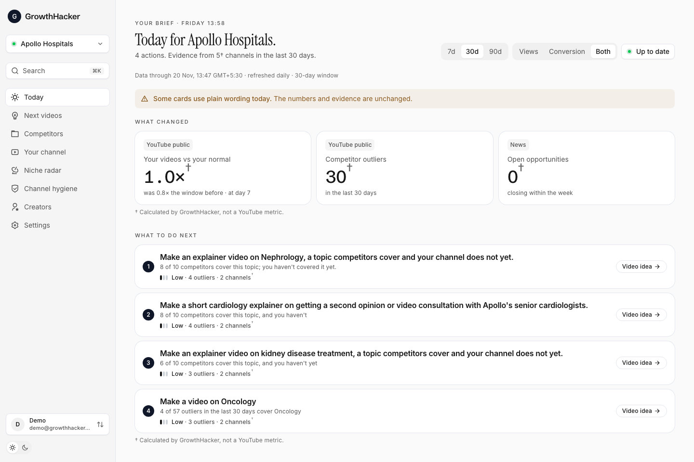
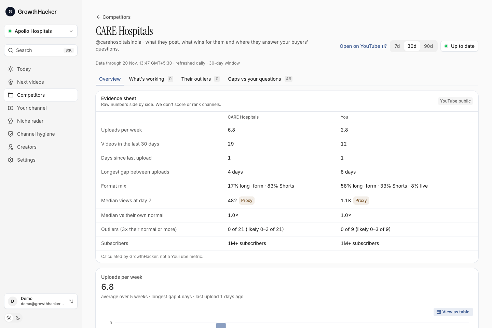
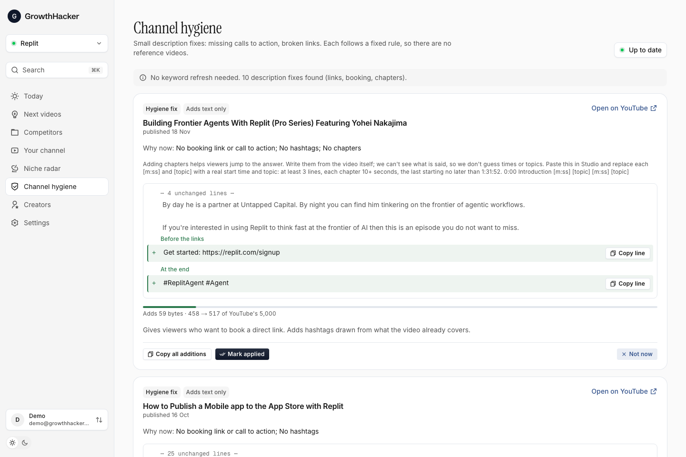
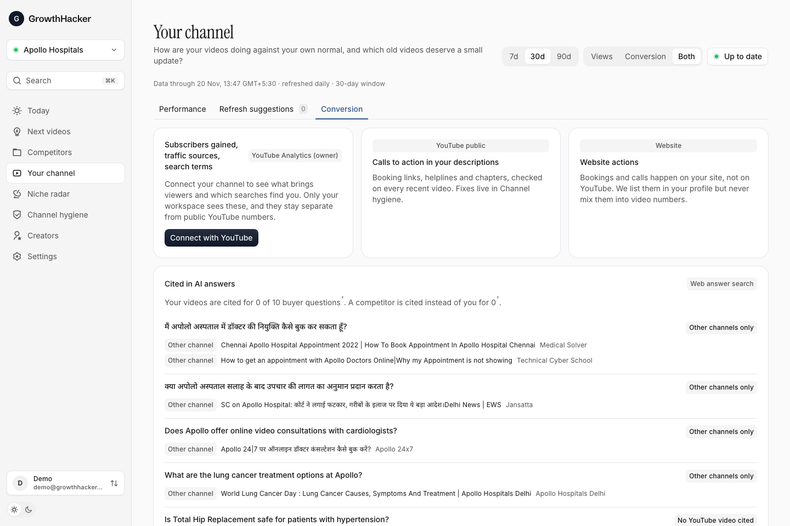
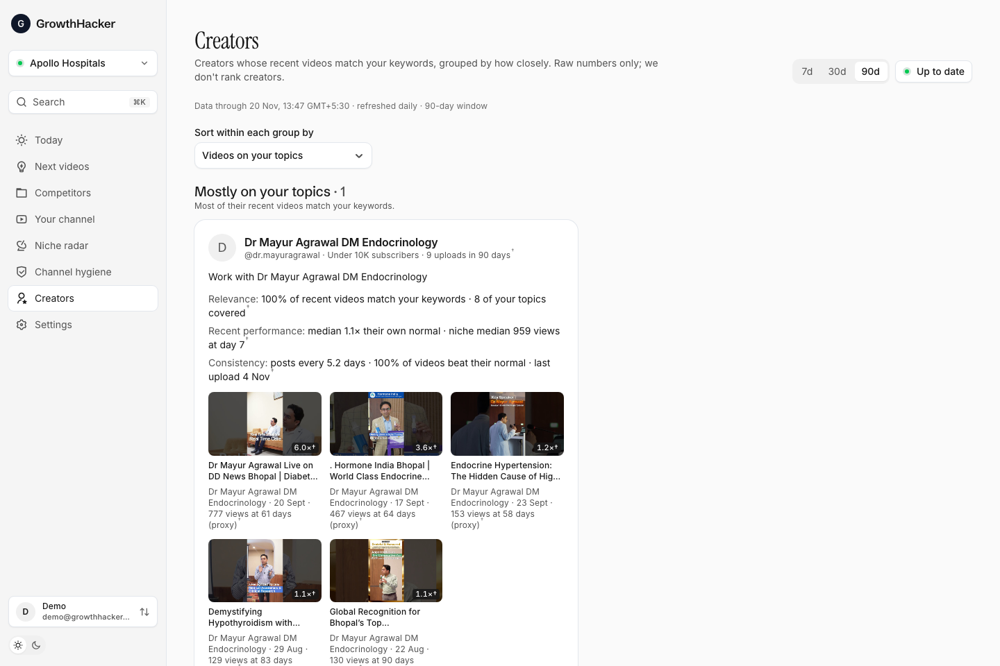
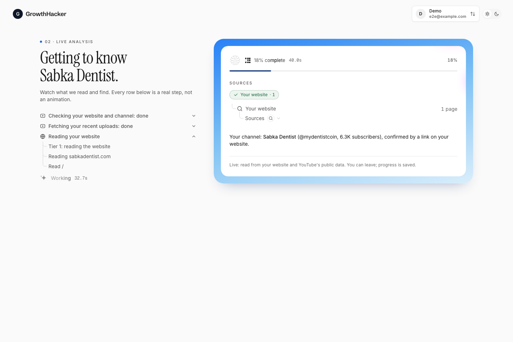
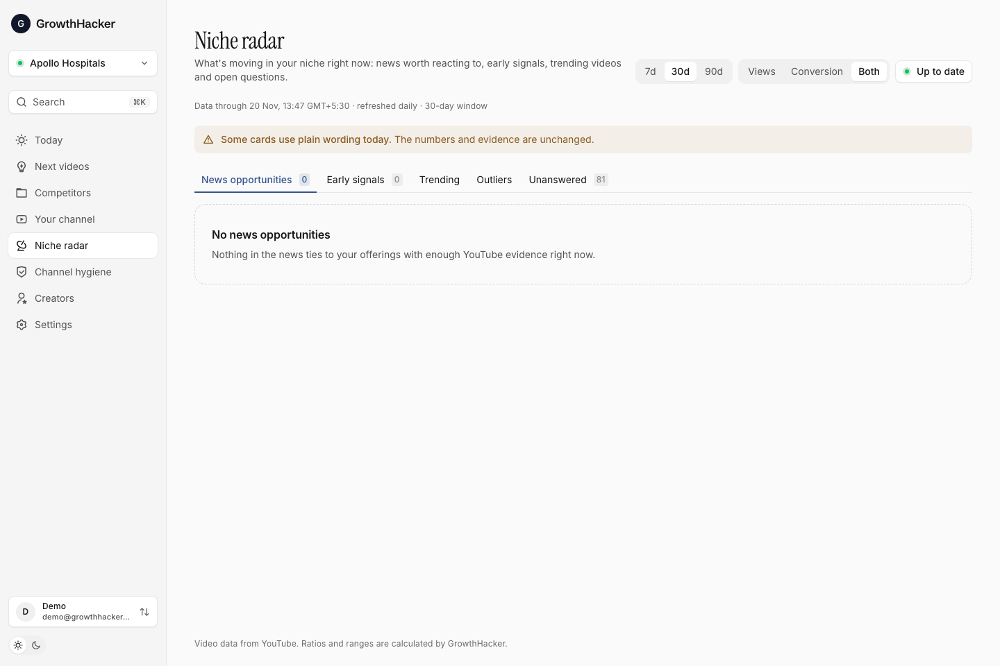

# GrowthHacker

GrowthHacker tells a business what to publish on YouTube next, what to fix in what it already published, and what its competitors are winning with. Every suggestion is backed by real, recent videos and tied to what the business sells.

You give it a website, a YouTube channel, or just a business name. It reads the site, finds the real competitors, tracks their videos, finds the ones that broke out against their own channel's normal, and turns that evidence into a short list of cards.

## Why it matters for a business

- **Ideas tied to buyers, not views alone.** Topics come from the business's own offerings and the questions its customers ask on its site. A card earns the "conversion" lens only when its reference videos directly answer a tracked buyer question.
- **Evidence you can check.** Each card cites at least three recent videos, with their views at the same age and how far they beat their own channel's normal. Numbers are computed by code; the language model only writes the wording and cannot add a number, video or name.
- **Honest when the data is thin.** If there aren't enough breakout videos in the window, the app says so ("Not enough outliers in the last 7 days. Widen to 30?") instead of guessing.
- **Fixes for videos already published.** Channel hygiene finds missing booking links, chapters and hashtags and gives paste-ready lines that only add text.
- **Competitors side by side.** Raw cadence, format mix and outliers per rival, with no made-up channel scores.
- **What AI answers cite.** For the top buyer questions, which YouTube videos web answer engines cite: yours, a competitor's, or someone else's.

## Screenshots

| | |
|---|---|
|  Today brief (Apollo Hospitals) |  Every idea opens its reference videos |
|  Competitor evidence sheet, raw numbers only |  Paste-ready description fixes (Replit) |
|  Who AI answers cite for each buyer question |  Creators grouped by relevance, not ranked |
|  Live analysis while onboarding |  Niche radar: news, early signals, trending |

More in [`docs/screenshots/`](docs/screenshots/).

## How it works

```
 website / channel / name
          │
          ▼
 ┌─────────────────┐   ┌──────────────────┐   ┌──────────────────────┐
 │ website intel   │──►│ competitor        │──►│ YouTube data layer    │
 │ crawl → profile │   │ discovery (3–10)  │   │ cached, quota-aware   │
 └─────────────────┘   └──────────────────┘   └──────────┬───────────┘
                                                         ▼
        ┌──────────────┐   ┌───────────────────────┐   ┌──────────────┐
        │ topic engine │──►│ metrics: views at age, │──►│ recommender  │
        │ client terms │   │ baselines, outliers,   │   │ gates, ≥3    │
        │ only         │   │ traits, lift           │   │ references   │
        └──────────────┘   └───────────────────────┘   └──────┬───────┘
          news radar ─────────────────────────────────────────┤
          refresh + hygiene ──────────────────────────────────┤
                                                              ▼
                                   card writer (wording only, validated) → UI

 FastAPI + arq workers on Redis · PostgreSQL 18 · Next.js UI · SSE live progress
 YouTube Data API v3 (+ Analytics API with owner consent) · Tavily · Anthropic
```

Design details, the data model, the quota plan and the policy check of every computed feature are in [`docs/DESIGN.md`](docs/DESIGN.md).

## Quickstart

Needs Python 3.12 with uv, Node.js with pnpm, PostgreSQL 18 and Redis (or `docker compose up postgres redis`).

```bash
cp .env.example .env    # add YOUTUBE_API_KEY, ANTHROPIC_API_KEY, TAVILY_API_KEY,
                        # GH_SECURITY__HASH_PEPPER, GH_SECURITY__TOKEN_ENCRYPTION_KEYS,
                        # GH_API__SESSION_COOKIE_SECURE=false

cd backend && uv sync && uv run alembic upgrade head
uv run python -m app.api.cli bootstrap --workspace "Demo" \
  --email demo@growthhacker.local --password 'growthhacker-demo' --auto-confirm
uv run uvicorn app.api.app:create_app --factory --port 8000 &
uv run arq app.workers.settings.InteractiveWorkerSettings &
uv run arq app.workers.settings.BatchWorkerSettings &
uv run arq app.workers.settings.MaintenanceWorkerSettings &

cd ../frontend && pnpm install && pnpm build && pnpm start -p 3000
```

Open <http://localhost:3000> and sign in as `demo@growthhacker.local` / `growthhacker-demo`. To look at the UI without any keys, run `pnpm dev:mock` in `frontend/`.

The full setup, API examples and troubleshooting are in [`docs/RUNBOOK.md`](docs/RUNBOOK.md).

## Demo walkthrough

1. **Add a client.** Clients → Add client → `apollohospitals.com`. The live panel shows pages being read, facts found, competitor folders landing and outliers appearing. Each item is a real progress event.
2. **Confirm the setup.** Review the profile, keywords, buyer questions and the proposed competitors (Fortis, Manipal, Medanta, Narayana, Max…). In the demo workspace this is automatic.
3. **Read the brief.** Today lists the cards for the chosen window (7, 30 or 90 days) with confidence and sample size. Switch the lens between Views and Conversion.
4. **Open the evidence.** Each card opens its reference videos with views at the same age, the channel's normal, and whether the value is observed or a labelled proxy.
5. **Competitors.** Open a folder for the evidence sheet: cadence, format mix, outliers, and the questions they answer that you don't.
6. **Channel hygiene.** Copy a suggested line into YouTube Studio and mark it applied.
7. **Thin data.** Switch Apollo to 7 days, or open Replit: the app explains why there are no cards and what widening the window would give.

Measured on 2026-11-20: Apollo has 0 / 4 / 7 cards in the 7 / 30 / 90-day windows; a warm daily refresh takes 77–109 s and 10–11 YouTube units per client. See [`docs/evaluation/EVALUATION.md`](docs/evaluation/EVALUATION.md).

## When a website blocks us

Many business sites sit behind bot protection or render everything in JavaScript. GrowthHacker never gives up on the profile, and never bypasses a block by force. It walks an acquisition cascade, in order, until the facts it needs are covered:

1. Our own polite crawler, respecting robots.txt, with an honest user agent and a compatible one after a WAF refusal.
2. A headless browser for JavaScript-only pages.
3. Reader services (Tavily extract and markdown readers) that fetch the page for us.
4. Search-index copies of the business's own pages.
5. Web archives (Wayback Machine, Common Crawl), labelled with the capture date.
6. Wikipedia and Wikidata.
7. What third parties say about the business.
8. The business's own YouTube channel.
9. Anything the user pastes or uploads.

Every fact records which tier it came from. Archived, encyclopaedic and third-party facts are shown as "needs your confirmation" and are never used until confirmed. There is no CAPTCHA solving and no proxy rotation.

## Evaluation

| item | status |
|---|---|
| Backtest vs "copy the top video" and random | Frozen and pre-registered at 2026-11-20; scoreable 2026-12-08 to 2026-12-17 |
| Outlier precision and recall | 115-video labelling pack ready for two labellers |
| Human review (target 4+) | Review pack with real cards and blinded decoys ready for two raters |
| Operations | Warm refresh p95 105 s (< 120 s); ~11 main units per client per refresh |

Details and how to finish the human parts: [`docs/evaluation/EVALUATION.md`](docs/evaluation/EVALUATION.md).

## Repository

| path | contents |
|---|---|
| `backend/` | FastAPI app, pipeline stages, services, workers, evaluation CLI, tests |
| `frontend/` | Next.js UI |
| `docs/DESIGN.md` | design review: architecture, data model, quota plan, feature policy check |
| `docs/RUNBOOK.md` | running the stack and the demos |
| `docs/MASTER_PLAN.md`, `docs/plans/` | the integration plan and the per-component plans |
| `docs/evaluation/` | evaluation status, ops report, policy matrix, labelling and review guides |
